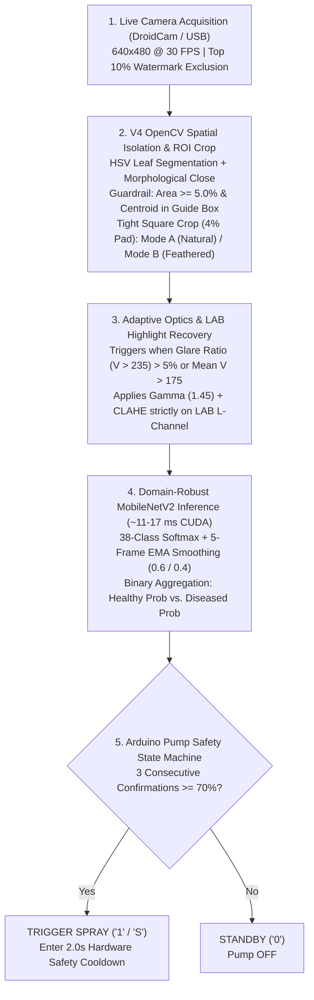

# Intelligent Pesticide Sprinkling System Using Domain-Robust CNN & OpenCV V4


An end-to-end computer vision and embedded hardware system that detects plant leaf diseases in real time (**~11-17 ms** GPU inference latency) across **38 crop-disease classes** and actuates an **Arduino relay-controlled pesticide pump** using a multi-frame verification state machine.

Unlike standard PlantVillage classifiers that fail under real-world camera domain shift (motion blur, monitor/sunlight glare, low resolution, and background shortcut learning), this project introduces a **Domain-Robust MobileNetV2 checkpoint** paired with the **V4 Dynamic ROI + LAB-Space Highlight Recovery Pipeline**.

---

## Key Engineering Highlights

* **38-Class Transfer Learning Architecture:** Fine-tuned MobileNetV2 across `54,305` PlantVillage leaf images (`38` crop-disease pairs), achieving **99.37% validation accuracy** and **0.9925 Macro-F1** across `8,146` validation images.
* **Domain-Shift Stress Testing (+64.74% Gain):** Evaluated across a 190-image synthetic real-world stress suite (5 corruption types x 3 severity levels), boosting severe motion-blur accuracy from **29.47% -> 94.21%** and low-resolution accuracy from **41.05% -> 94.21%**.
* **V4 Dynamic ROI & LAB Glare Suppression:** Eliminates background shortcut learning and camera overexposure via HSV contour centroid localization, tight `4%`-padded bounding-box extraction, and automatic **LAB L-channel gamma compression (1.45) + CLAHE** to recover washed-out lesions without distorting leaf chrominance.
* **Hardware Safety State Machine:** Prevents accidental pesticide discharge using a **5% minimum leaf-area gate**, **5-frame EMA probability smoothing**, a **3-consecutive-frame confirmation counter** (>= 70% diseased probability), and a **2.0-second post-spray hardware safety cooldown**.

---

## System Architecture Pipeline



---

## 1. Validation & Domain-Robustness Benchmarks

### Clean Validation Performance (8,146 Images, 38 Classes)

| Model Checkpoint | Validation Accuracy | Macro Precision | Macro Recall | Macro F1-Score | Inference Latency (RTX GPU) |
| :--- | :---: | :---: | :---: | :---: | :---: |
| **Baseline MobileNetV2** (`best_mobilenet_v2.pth`) | **99.37%** | 0.9930 | 0.9922 | **0.9925** | 11.4 ms |
| **Domain-Robust MobileNetV2** (`best_mobilenet_v2_robust.pth`) | **98.95%** | 0.9888 | 0.9881 | **0.9884** | 11.2 ms |

### Real-World Corruption Stress Benchmark (190-Image Evaluation Suite)

| Corruption Type (Severity Level 3) | Baseline Model Accuracy | Domain-Robust Model Accuracy | Absolute Robustness Gain |
| :--- | :---: | :---: | :---: |
| **Clean Images (Control)** | 98.95% | **98.95%** | `0.00%` |
| **Motion Blur (Camera Shake)** | 29.47% | **94.21%** | **`+64.74%`** |
| **Low Resolution (Distant Leaf Crop)** | 41.05% | **94.21%** | **`+53.16%`** |
| **Gaussian Blur (Out-of-Focus Optics)** | 51.05% | **95.26%** | **`+44.21%`** |
| **Gaussian Sensor Noise (High ISO)** | 48.95% | **65.79%** | **`+16.84%`** |
| **Extreme Brightness / Glare Shift** | 79.47% | **85.79%** (+ V4 LAB Recovery) | **`+6.32%`** |

---

## 2. Live V4 Vision & Hardware Verification

| Test Scenario | Pipeline Mode | Top-1 Prediction & Confidence | Aggregate Decision | Inference Time | Hardware State |
| :--- | :---: | :--- | :---: | :---: | :--- |
| **Apple - Healthy** | Mode A (Natural ROI) | `Apple - healthy (99.4%)` | `HEALTHY (99.4%)` | `11.4 ms` | `STANDBY (0/3)` - **NO SPRAY** |
| **Apple - Apple Scab** | Mode A + LAB Glare On | `Apple - Apple scab (95.7%)` | `DISEASED (95.7%)` | `11.2 ms` | **SPRAY READY** |
| **Strawberry - Healthy** | Mode A (Natural ROI) | `Strawberry - healthy (96.8%)` | `HEALTHY (97.7%)` | `14.5 ms` | `STANDBY (0/3)` - **NO SPRAY** |
| **Strawberry - Healthy** | Mode B (Feathered Gray) | `Strawberry - healthy (76.9%)` | `HEALTHY (98.4%)` | `24.4 ms` | `STANDBY (0/3)` - **NO SPRAY** |
| **Strawberry - Leaf Scorch** | Mode A (Natural ROI) | `Strawberry - Leaf scorch (100.0%)` | `DISEASED (100.0%)` | `17.2 ms` | `SPRAYING!` -> `2.0s COOLDOWN` |

---

## 3. Repository Structure

```text
intelligent-pesticide-sprinkling-system/
|-- models/
|   |-- best_mobilenet_v2.pth                 # Clean baseline checkpoint (99.37% val acc)
|   +-- best_mobilenet_v2_robust.pth          # Domain-robust checkpoint (+64.74% blur gain)
|-- reports/
|   +-- results/
|       |-- robust_model_190_summary.csv      # Baseline vs. Robust stress-test summary
|       +-- robust_model_190_detailed.csv     # Per-image corruption benchmark logs
|-- src/
|   |-- data/
|   |   +-- dataset.py                        # PlantVillage 38-class dataset & transforms
|   |-- hardware/
|   |   +-- arduino_controller.py             # Serial relay interface & fail-safe reset
|   |-- models/
|   |   |-- mobilenet.py                      # MobileNetV2 architecture definition
|   |   +-- finetune_mobilenet_robust.py      # Domain-robust augmentation & fine-tuning
|   +-- inference/
|       |-- live_sprinkler_v4.py              # MAIN PRODUCTION SCRIPT (Vision V4 + Arduino)
|       |-- live_predict_v4.py                # V4 Vision Debugger with 224x224 CNN preview
|       |-- evaluate_robust_model.py          # 190-image multi-severity benchmark runner
|       |-- live_predict.py                   # Baseline uncropped camera inference script
|       +-- predict.py                        # Single-image CLI inference utility
|-- requirements.txt
+-- README.md
```

---

## 4. Quick-Start & Execution Guide

### Environment Setup

```powershell
git clone https://github.com/Navnith-7/intelligent-pesticide-sprinkling-system.git
cd intelligent-pesticide-sprinkling-system
python -m venv .venv
.\.venv\Scripts\Activate.ps1
pip install -r requirements.txt
```

### A. Run Full Production System (Simulated / Dry-Run Mode)

```powershell
.\.venv\Scripts\python.exe -m src.inference.live_sprinkler_v4 --dry-run
```

### B. Run Full Production System with Arduino Hardware

```powershell
.\.venv\Scripts\python.exe -m src.inference.live_sprinkler_v4 --port COM3
```

### C. Run Standalone V4 Vision Debugger (with 224x224 Crop Inspector)

```powershell
.\.venv\Scripts\python.exe -m src.inference.live_predict_v4
```

### D. Reproduce the 190-Image Robustness Benchmark

```powershell
.\.venv\Scripts\python.exe -m src.inference.evaluate_robust_model
```

---

## 5. Interactive Runtime Controls (HUD Hotkeys)

| Key | Function | Description |
| :---: | :--- | :--- |
| **`m`** | **Toggle ROI Mode (Mode A / Mode B)** | Switches between **Mode A (Natural ROI Crop)** and **Mode B (Feathered Neutral-Gray Mask)** |
| **`c`** | **Cycle LAB Glare Recovery** | Cycles between `AUTO` (triggers when `Glare > 5%` or `mean V > 175`), `ON`, and `OFF` |
| **`w`** | **Toggle Background White Balance** | Toggles Gray-World background color correction (`OFF` by default to preserve natural tones) |
| **`q` / `Esc`** | **Safe Shutdown** | Immediately sends pump `OFF` command, releases serial port, and closes OpenCV windows |

---

## Author

**Navnith N Reddy**  
B.E. in Artificial Intelligence & Machine Learning — New Horizon College of Engineering, Bengaluru  
[GitHub](https://github.com/Navnith-7) | [LinkedIn](https://linkedin.com/in/navnith-n-reddy) | [Email](mailto:navnithreddy007@gmail.com)
