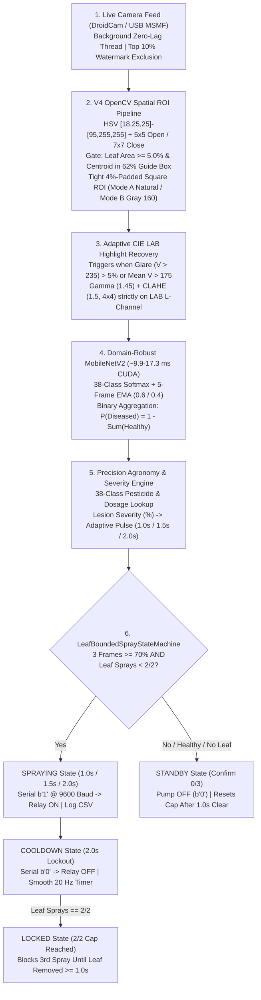
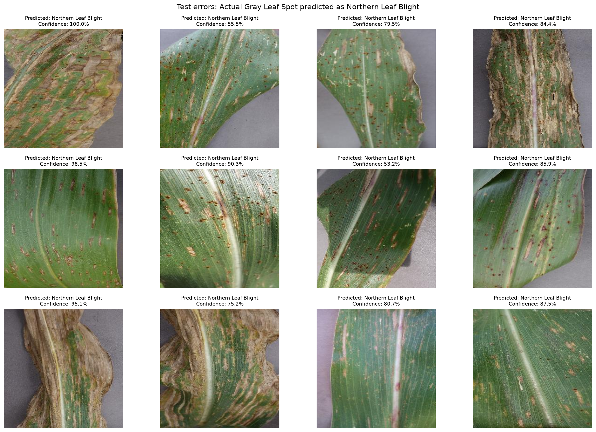
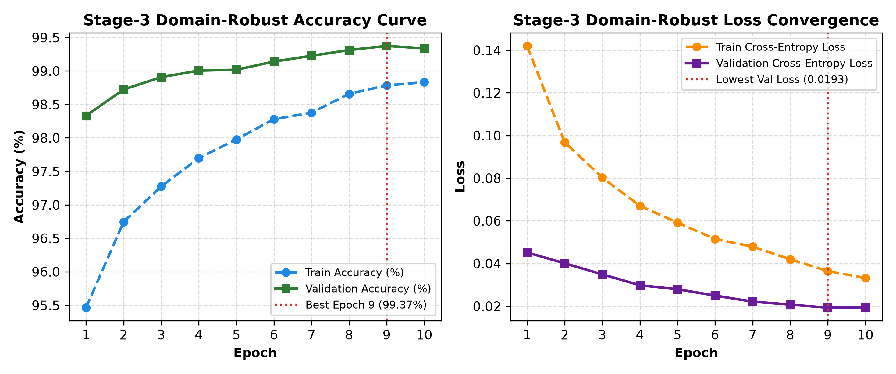

# Intelligent Pesticide Sprinkling System Using CNN


An end-to-end **computer vision, precision agronomy, and embedded hardware actuation system** for real-time plant disease recognition and targeted pesticide spraying. Built with **PyTorch**, **OpenCV**, **Streamlit**, and an **Arduino Uno serial relay controller**, this project progresses systematically from a custom 4-block CNN baseline to a **Stage-3 Domain-Robust MobileNetV2 (99.37% val accuracy)** paired with the **V4 Spatial ROI & CIE LAB Glare-Recovery Vision Pipeline** and the **V5 Precision Control Console** (38-class pesticide formulary, variable-rate lesion severity spray timing, and a strict per-leaf 2-spray cap).

---

## Live System Demos

### 1. End-to-End Hardware Actuation Demo (Arduino Uno + Relay + Water Pump on `COM6`)


https://github.com/user-attachments/assets/464b7ec5-434d-4a9f-9c90-0df534bf94f5


### 2. V4 Vision Pipeline & State Machine Deep-Dive (`11-17 ms` CUDA Inference)


https://github.com/user-attachments/assets/a3c0abf9-e1af-4786-a0a8-c04ff95a3dbc

---

## Key Engineering Highlights

* **Zero-Leakage SHA-256 Hash-Isolated Splits:** Audited all **54,305** PlantVillage leaf images across **38 classes**, isolating **21 exact duplicate hash pairs (42 files)** so identical images never cross train (`38,012`), validation (`8,146`), or held-out test (`8,147`) boundaries (`seed = 42`).
* **4-Stage Model Progression (Custom CNN -> Domain-Robust MobileNetV2):**
  * **Custom 4-Block CNN (`best_cnn.pth`, 1.73 MB):** Achieved **97.64%** val accuracy (**97.40%** test accuracy, `0.9634` Macro-F1, `212` test errors). Diagnostic error analysis revealed confusion on fine-grained intra-species lesions (*Corn Gray Leaf Spot* vs. *Northern Leaf Blight*).
  * **3-Stage MobileNetV2 Transfer Learning (`best_mobilenet_v2_robust.pth`, 9.35 MB):** Progressed from classifier-head warm-up (**97.35%** val) -> partial top-block fine-tuning (**98.43%** val, **98.49%** test, `123` errors) -> full-network (`2,272,550` params, `LR = 1e-5`) domain-robust fine-tuning, reaching **99.37% validation accuracy**, **0.9925 Macro-F1**, and **`0.0193` validation loss**.
* **Major Domain-Shift Robustness Gains (`n = 190` Stratified Stress Suite):** Boosted accuracy by **+64.74% under 9x9 motion blur** (`29.47% -> 94.21%`), **+53.16% under 1/4x low resolution** (`41.05% -> 94.21%`), **+16.84% under severe low-light sensor noise** (`35.26% -> 52.11%`), and **+13.16% under JPEG Q=25 compression** (`82.11% -> 95.26%`).
* **V4 Real-Time OpenCV Optical Pipeline (`~9.9–17.3 ms` CUDA):** Eliminates background shortcut learning and specular glare via top-10% watermark exclusion, HSV leaf segmentation (`[18, 25, 25]` to `[95, 255, 255]`), centroid-in-guide-box verification (`>= 5.0%` area), tight `4%`-padded square ROI extraction (**Mode A: Natural Crop** / **Mode B: 15px Feathered Neutral-Gray `160` Mask**), and automatic **CIE LAB L-channel Gamma (`1.45`) + CLAHE (`clipLimit=1.5`, `4x4`)** highlight recovery.
* **V5 Streamlit Control Console & Precision Agronomy Layer (`streamlit_app.py`, `pesticide_recommendation.py`):**
  * **38-Class Pesticide & Dosage Formulary:** Maps every crop-disease pair to its specific fungicide/bactericide/miticide, active ingredient, pathogen classification, and mixing dosage (`g/L` or `mL/L`).
  * **Variable-Rate Adaptive Spray Duration:** Segments foliar chlorosis/necrosis on the cropped ROI to compute **Lesion Severity (%)** and scales pump pulse time dynamically (**Mild `<12%` -> `1.0s`**, **Moderate `12–30%` -> `1.5s`**, **Severe `>30%` -> `2.0s`**).
  * **Hard Per-Leaf 2-Spray Limiter:** Automatically locks actuation (`LOCKED 2/2`) after 2 pulses on the same diseased leaf until the leaf leaves the frame for `1.0s`, preventing phytotoxic over-spraying.
  * **Fail-Safe Arduino State Machine & Chemical Savings Telemetry:** Enforces 5-frame EMA smoothing (`0.6/0.4`), 3 consecutive disease confirmations (`>= 70%`), `2.0s` cooldown lockouts, guaranteed `b'0'` shutoff on exit/fault, live chemical-saved (`%`) tracking, and one-click CSV audit log export.

---

## System Architecture



---

## Experimental Benchmarks & Visual Results

### 1. Four-Stage Model Progression (Clean Validation `8,146` imgs & Held-Out Test `8,147` imgs)

| Model Checkpoint | Architecture & Training Strategy | Model Size | Best Epoch | Val Loss | Val Accuracy | Val Macro-F1 | Held-Out Test Accuracy | Held-Out Test Macro-F1 |
| :--- | :--- | :---: | :---: | :---: | :---: | :---: | :---: | :---: |
| `best_cnn.pth` | Custom 4-Block CNN (`~422k` params, from scratch) | 1.73 MB | 14 / 19 | `0.0763` | 97.64% | 0.9685 | 97.40% (`7,935/8,147`) | 0.9634 |
| `best_mobilenet_v2.pth` | Stage 1: Frozen Backbone + Linear Head (`LR = 1e-3`) | 9.34 MB | 11 / 16 | `0.0822` | 97.35% | 0.9653 | — | — |
| `best_mobilenet_v2_finetuned.pth` | Stage 2: Unfroze `features[-2:]` + Head (`LR = 1e-5 / 1e-4`) | 9.35 MB | 9 / 12 | `0.0485` | 98.43% | 0.9789 | **98.49%** (`8,024/8,147`) | **0.9796** |
| **`best_mobilenet_v2_robust.pth`** | **Stage 3: Full-Network (`2.27M` params, `LR = 1e-5`) + Robust Aug** | **9.35 MB** | **9 / 10** | **`0.0193`** | **99.37%** | **0.9925** | *Untouched per ML policy* | — |


<details>
<summary><strong>View Custom CNN Diagnostic Error Analysis (Why We Upgraded to MobileNetV2)</strong></summary>



</details>

### 2. 190-Image Stratified Domain-Shift Stress Benchmark (Baseline vs. Domain-Robust MobileNetV2)

Evaluated via `src/inference/evaluate_robustness.py` and `src/inference/evaluate_robust_model.py` across the exact same deterministic stratified subset (**190 images**: 5 images per class across all 38 classes, `seed = 42`):

| Condition | Synthetic Corruption Specification | Baseline Correct | Baseline Accuracy | Baseline Macro-F1 | Robust Correct | Robust Accuracy | Robust Macro-F1 | Accuracy Gain | Macro-F1 Gain |
| :--- | :--- | :---: | :---: | :---: | :---: | :---: | :---: | :---: | :---: |
| **`original`** | Unaltered RGB (`224x224`) | 186 / 190 | 97.89% | 0.9788 | **189 / 190** | **99.47%** | **0.9947** | **`+1.58%`** | **`+0.0159`** |
| **`motion_blur`** | `9x9` Horizontal Motion Blur Filter | 56 / 190 | 29.47% | 0.2726 | **179 / 190** | **94.21%** | **0.9433** | **`+64.74%`** | **`+0.6706`** |
| **`low_resolution`** | `1/4x` Downscale -> Linear Upscale | 78 / 190 | 41.05% | 0.3923 | **179 / 190** | **94.21%** | **0.9409** | **`+53.16%`** | **`+0.5486`** |
| **`low_light_noise`** | `0.40x` Brightness + Gaussian `N(0, 10)` | 67 / 190 | 35.26% | 0.3162 | **99 / 190** | **52.11%** | **0.5367** | **`+16.84%`** | **`+0.2205`** |
| **`jpeg_compression`** | OpenCV JPEG Compression (`quality = 25`) | 156 / 190 | 82.11% | 0.8218 | **181 / 190** | **95.26%** | **0.9525** | **`+13.16%`** | **`+0.1307`** |


### 3. Stage-3 Domain-Robust Training & Loss Convergence (10 Epochs)



### 4. Multi-Severity Degradation Sensitivity Curve (Baseline Vulnerability Analysis)

| Corruption Type | Mild Severity | Moderate Severity | Severe Stress | Engineering Mitigation Implemented |
| :--- | :---: | :---: | :---: | :--- |
| **Motion Blur** | `3x3`: **96.32%** (`183/190`) | `5x5`: **71.58%** (`136/190`) | `9x9`: **29.47%** (`56/190`) | `RandomMotionBlur` (`p=0.25`) in Stage-3 training |
| **Low Resolution** | `0.75x`: **96.32%** (`183/190`) | `0.50x`: **89.47%** (`170/190`) | `0.25x`: **41.05%** (`78/190`) | `RandomDownscale` (`p=0.25`) + tight `4%` ROI crop |
| **Low Light** | `0.75x`: **97.37%** (`185/190`) | `0.55x`: **86.84%** (`165/190`) | `0.40x`: **60.00%** (`114/190`) | ColorJitter + conditional LAB `L`-channel CLAHE |
| **JPEG Artifacts** | `Q=70`: **98.42%** (`187/190`) | `Q=40`: **92.11%** (`175/190`) | `Q=25`: **82.11%** (`156/190`) | `RandomJPEGCompression(40, 95)` (`p=0.20`) |

### 5. Live V4/V5 Camera & Arduino Hardware Verification

| Test Leaf Sample | Vision Mode | Top-1 Prediction | Top-1 Conf. | Aggregate Status | Hardware State Machine | CUDA Latency |
| :--- | :---: | :--- | :---: | :--- | :--- | :---: |
| **Apple — Healthy** | Mode A (Natural ROI) | `Apple - healthy` | **99.4%–100%** | `HEALTHY (100.0%)` | `STANDBY (0/3)` | 9.9–11.4 ms |
| **Apple — Apple Scab** | Mode A (Natural ROI) | `Apple - Apple scab` | **95.7%** | `DISEASED (95.7%)` | `SPRAYING -> COOLDOWN` | 11.2 ms |
| **Apple — Black Rot** | Mode A (`COM6 @ 9600`) | `Apple - Black rot` | **99.9%–100%** | `DISEASED (100.0%)` | `PHYSICAL PUMP ON -> COOLDOWN` | 8.9–11.1 ms |
| **Peach — Healthy** | Mode A (Natural ROI) | `Peach - healthy` | **97.3%** | `HEALTHY (97.6%)` | `STANDBY (0/3)` | 14.9 ms |
| **Peach — Bacterial Spot** | Mode A (28% Glare, LAB ON) | `Peach - Bacterial spot` | **99.7%** | `DISEASED (100.0%)` | `SPRAYING (2/2 Cap) -> LOCKED` | 13.5–17.3 ms |
| **Strawberry — Healthy** | Mode A / Mode B | `Strawberry - healthy` | **96.8% / 76.9%** | `HEALTHY (97.7–98.4%)` | `STANDBY (0/3)` | 14.5 / 24.4 ms |
| **Strawberry — Leaf Scorch** | Mode A (Natural ROI) | `Strawberry - Leaf scorch` | **100.0%** | `DISEASED (100.0%)` | `SPRAYING -> COOLDOWN` | 12.5 ms |

---

## Method Ablation: V1 Baseline vs. V4/V5 Production

| Engineering Dimension | V1 Baseline (`automated_sprinkler.py`) | V4/V5 Production (`live_sprinkler_v4.py` & `streamlit_app.py`) |
| :--- | :--- | :--- |
| **Dataset Split Integrity** | Standard random split (21 duplicate pairs leak) | SHA-256 hash-grouped stratified 70/15/15 split (`0` leakage) |
| **Spatial Leaf Gate** | None (full uncropped `640x480` webcam frame) | Top-10% watermark mask + HSV ROI (`>= 5.0%` area, `4%` pad, 62% guide box) |
| **Glare & Exposure** | Raw RGB (specular glare bleaches lesions) | Conditional CIE LAB `L`-channel Gamma (`1.45`) + CLAHE (`1.5`, `4x4`) |
| **Temporal Stability** | Single-frame raw softmax (chattering) | 5-frame EMA (`0.6/0.4`) + 3 consecutive confirmations (`>= 70%`) |
| **Spray Pulse & Leaf Cap** | Fixed `1.5s`, unlimited sprays on one leaf | Adaptive severity pulse (`1.0s`/`1.5s`/`2.0s`) + hard **2-spray/leaf cap** (`1.0s` clear reset) |
| **Agronomy Prescription** | Binary disease class label only | 38-class pesticide, active ingredient, mixing dosage & CSV audit export |
| **Hardware Fault Safety** | Crashes if `COM6` disconnected | Auto-fallback to `DRY-RUN`; `2.0s` Uno boot reset; guaranteed `b'0'` shutoff on exit |

---

## Quickstart & Execution Commands

> **Pre-Trained Model Weights:** Download **`best_mobilenet_v2_robust.pth`** (`8.91 MB`) from the GitHub **Releases (`v5.0.0`)** tab and place it inside `models/`.

```powershell
# 1. Install Dependencies
pip install -r requirements.txt

# 2. Launch V5 Integrated Streamlit Control Console (4-Tab Web Dashboard)
.\.venv\Scripts\streamlit.exe run src/inference/streamlit_app.py

# 3. Run Standalone CLI V4 Sprinkler (Simulation / Dry-Run Mode)
.\.venv\Scripts\python.exe -m src.inference.live_sprinkler_v4 --dry-run

# 4. Run Standalone CLI V4 Sprinkler (Live Arduino Hardware on COM6)
.\.venv\Scripts\python.exe -m src.inference.live_sprinkler_v4 --port COM6 --baud 9600

# 5. Reproduce All 190-Image Stress Benchmarks & 300-DPI Charts
.\.venv\Scripts\python.exe -m src.inference.evaluate_robustness
.\.venv\Scripts\python.exe -m src.inference.evaluate_robust_model
.\.venv\Scripts\python.exe src/utils/plot_benchmarks.py

# 6. Run Dataset Integrity & Tensor Unit Tests
.\.venv\Scripts\python.exe -m tests.test_dataset
```

---

## Repository Structure

```text
intelligent-pesticide-sprinkling-system/
├── arduino/sprinkler_relay/sprinkler_relay.ino  # Arduino Uno 9600-baud active-low relay firmware
├── data/                                        # SHA-256 leak-free train/val/test split manifests
├── reports/
│   ├── figures/                                 # 300-DPI benchmark charts & diagnostic error plots
│   └── results/                                 # Epoch histories & 190-image stress CSV logs
├── src/
│   ├── inference/
│   │   ├── streamlit_app.py                     # V5 4-tab control console (2-spray cap, severity, logs)
│   │   ├── pesticide_recommendation.py          # 38-class pesticide formulary & lesion severity engine
│   │   ├── live_sprinkler_v4.py                 # CLI fail-safe hardware state machine
│   │   ├── live_predict_v4.py                   # V4 OpenCV HSV ROI + CIE LAB glare recovery pipeline
│   │   ├── evaluate_robustness.py               # Baseline 190-image degradation benchmark
│   │   └── evaluate_robust_model.py             # Robust MobileNetV2 190-image benchmark
│   ├── models/                                  # Custom 4-block CNN & 3-stage MobileNetV2 training
│   └── utils/plot_benchmarks.py                 # Reproducible 300-DPI benchmark chart generator
├── tests/test_dataset.py                        # Split leakage & tensor shape verification
├── LICENSE                                      # MIT License
└── requirements.txt
```

---

## Author

**Navnith N Reddy**  
B.E. in Artificial Intelligence & Machine Learning  
[GitHub](https://github.com/Navnith-7) | [LinkedIn](https://linkedin.com/in/navnith-n-reddy)
