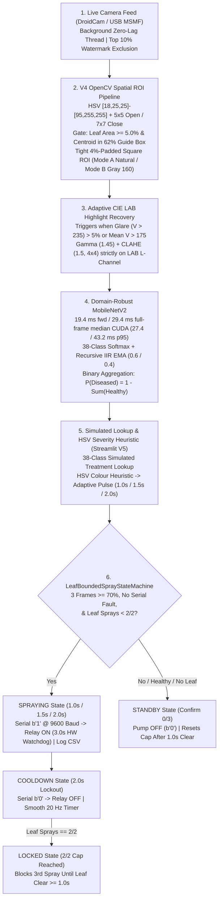
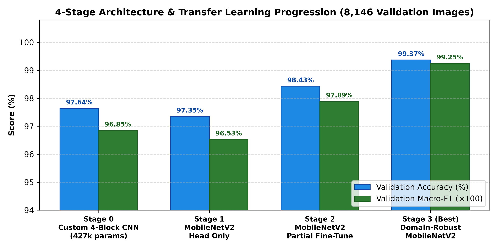
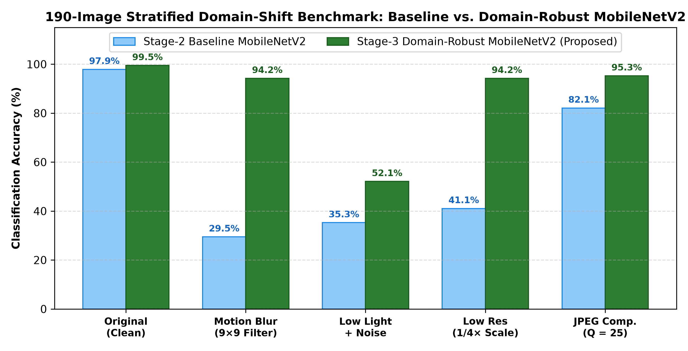

# Intelligent Pesticide Sprinkling System Using CNN


An end-to-end **computer vision and embedded hardware water-based prototype** for real-time plant disease recognition and targeted water-pump actuation (the benchtop pump dispenses water only, not chemical pesticides). Built with **PyTorch**, **OpenCV**, **Streamlit**, and an **Arduino Uno serial relay controller**, this project progresses systematically from a custom 4-block CNN baseline to a **Stage-3 Domain-Robust MobileNetV2 (99.37% validation accuracy, 99.37% held-out test accuracy)** paired with the **V4 Spatial ROI & CIE LAB Glare-Recovery Vision Pipeline** and the **V5 Control Console** (38-class simulated treatment lookup table, HSV lesion-severity pulse heuristic, and a configurable per-leaf 2-spray cap).

---

## Live System Demos

### 1. End-to-End Hardware Actuation Demo (Arduino Uno + Relay + Water Pump on `COM6`)


https://github.com/user-attachments/assets/464b7ec5-434d-4a9f-9c90-0df534bf94f5


### 2. V5 Streamlit Control Console & 2-Spray Leaf Cap


https://github.com/user-attachments/assets/cc8bf4f7-4ea2-4e01-91cf-e7933b6d1dd9


---

## Key Engineering Highlights

* **Leakage-Safe Splits (Exact Duplicates Grouped by SHA-256):** Audited all **54,305** PlantVillage leaf images across **38 classes**, isolating **21 exact duplicate hash pairs (42 files)** so byte-identical images never cross train (`38,012`), validation (`8,146`), or held-out test (`8,147`) boundaries (`seed = 42`). Note: deduplication uses exact byte-level SHA-256 hashing only and does not group near-duplicates (e.g., multiple photos of the same physical leaf).
* **4-Stage Model Progression (Custom CNN -> Domain-Robust MobileNetV2):**
  * **Custom 4-Block CNN (`best_cnn.pth`, 1.73 MB / 1.65 MiB, `427,174` params):** Achieved **97.64%** validation accuracy (**97.40%** held-out test accuracy, `0.9634` test Macro-F1, `212` test errors). Diagnostic error analysis revealed confusion on fine-grained intra-species lesions (*Corn Gray Leaf Spot* vs. *Northern Leaf Blight*).
  * **3-Stage MobileNetV2 Transfer Learning (`best_mobilenet_v2_robust.pth`, 9.35 MB / 8.91 MiB):** Progressed from classifier-head warm-up (**97.35%** val) -> partial top-block fine-tuning (**98.43%** val, **98.49%** test, `123` errors) -> full-network (`2,272,550` params, `LR = 1e-5`) domain-robust fine-tuning, reaching **99.37% validation accuracy** (`0.9925` val Macro-F1, `0.0193` val loss) and **99.37% held-out test accuracy** (`8,096/8,147`, `0.9906` test Macro-F1, **`51` errors**).
* **Synthetic Domain-Shift Robustness Gains (`n = 190` Stratified Validation Subset):** Boosted accuracy by **+64.74% under synthetic 9x9 motion blur** (`29.47% -> 94.21%`), **+53.16% under synthetic 1/4x low resolution** (`41.05% -> 94.21%`), **+16.84% under synthetic low-light sensor noise** (`35.26% -> 52.11%`), and **+13.16% under synthetic JPEG Q=25 compression** (`82.11% -> 95.26%`).
* **V4 Real-Time OpenCV Optical Pipeline (`19.4 ms` forward / `29.4 ms` full-frame median CUDA; `27.4 ms` / `43.2 ms` p95):** Measured on an NVIDIA GeForce RTX 5050 Laptop GPU (Windows 11, PyTorch `2.14.1+cu130`, CUDA `13.0`, logged in `reports/results/stage3_latency_benchmark.csv`). Reduces background shortcut learning and specular glare via top-10% watermark exclusion, HSV leaf segmentation (`[18, 25, 25]` to `[95, 255, 255]`), centroid-in-guide-box verification (`>= 5.0%` area), tight `4%`-padded square ROI extraction (**Mode A: Natural Crop** / **Mode B: 15px Feathered Neutral-Gray `160` Mask**), and automatic **CIE LAB L-channel Gamma (`1.45`) + CLAHE (`clipLimit=1.5`, `4x4`)** highlight recovery.
* **V5 Streamlit Control Console (`streamlit_app.py`, `pesticide_recommendation.py`):**
  * **38-Class Treatment Lookup Table (Simulated):** Maps every PlantVillage crop-disease class to a demonstration fungicide/bactericide/miticide entry, active ingredient, pathogen name, and mixing dosage (`g/L` or `mL/L`). *This is a simulated lookup table, not validated agronomic advice.* `[TODO: add agronomic sources for dosages]`
  * **Variable-Rate Adaptive Spray Duration (HSV Heuristic):** Uses an **unvalidated HSV colour-threshold heuristic** (HSV only—no LAB, not expert-validated, and not meaningful for viral, mite, or citrus-greening classes) on the cropped ROI to compute an estimated lesion ratio and map pulse duration (**Mild `<12%` -> `1.0s`**, **Moderate `12–30%` -> `1.5s`**, **Severe `>30%` -> `2.0s`**). Displayed volume (`mL`) uses an **assumed, uncalibrated `12.0 mL/s`** flow rate.
  * **Hard Per-Leaf 2-Spray Limiter (Streamlit V5):** Automatically locks actuation (`MAX_REACHED` / `LOCKED 2/2`) after 2 pulses on the same diseased leaf until the leaf leaves the frame (or reads non-diseased) for `1.0s`.
  * **Fail-Safe Arduino State Machine & Frame-Ratio Savings Telemetry:** Enforces recursive IIR EMA smoothing (`0.6/0.4`), 3 consecutive disease confirmations (`>= 70%`), `2.0s` cooldown lockouts, serial-fault spray blocking, guaranteed `b'0'` shutoff on exit, a **`3.0s` Arduino firmware watchdog** (`MAX_ON_MS = 3000UL`), live frame-ratio `Chemical Saved (%)` tracking, and CSV audit log export.

---

## System Architecture



---

## Experimental Benchmarks & Visual Results

### 1. Four-Stage Model Progression (Validation `8,146` imgs & Held-Out Test `8,147` imgs)

| Model Checkpoint | Architecture & Training Strategy | Model Size | Best Epoch | Val Loss | Val Accuracy | Val Macro-F1 | Held-Out Test Accuracy | Held-Out Test Macro-F1 |
| :--- | :--- | :---: | :---: | :---: | :---: | :---: | :---: | :---: |
| `best_cnn.pth` | Custom 4-Block CNN (`427,174` params, from scratch) | 1.73 MB (1.65 MiB) | 14 / 19 | `0.0763` | 97.64% | 0.9685 | 97.40% (`7,935/8,147`, 212 err) | 0.9634 |
| `best_mobilenet_v2.pth` | Stage 1: Frozen Backbone + Linear Head (`LR = 1e-3`) | 9.34 MB (8.91 MiB) | 11 / 16 | `0.0822` | 97.35% | 0.9653 | — | — |
| `best_mobilenet_v2_finetuned.pth` | Stage 2: Unfroze `features[-2:]` + Head (`LR = 1e-5 / 1e-4`) | 9.35 MB (8.91 MiB) | 9 / 12 | `0.0485` | 98.43% | 0.9789 | 98.49% (`8,024/8,147`, 123 err) | 0.9796 |
| **`best_mobilenet_v2_robust.pth`** | **Stage 3: Full-Network (`2,272,550` params, `LR = 1e-5`) + Robust Aug** | **9.35 MB (8.91 MiB)** | **9 / 10** | **`0.0193`** | **99.37%** | **0.9925** | **99.37%** (`8,096/8,147`, **51 err**) | **0.9906** |



<details>
<summary><strong>View Custom CNN Diagnostic Error Analysis (Why We Upgraded to MobileNetV2)</strong></summary>


</details>

### 2. 190-Image Synthetic Domain-Shift Stress Benchmark (Baseline vs. Domain-Robust MobileNetV2)

Evaluated via `src/inference/evaluate_robustness.py` (Stage 2) and `src/inference/evaluate_robust_model.py` (Stage 3) across the same deterministic stratified subset sampled from **`data/processed/validation.csv`** (**190 images**: 5 images per class across all 38 classes, `seed = 42`; **0 overlap** with `train.csv` or `test.csv`, though note `validation.csv` is the same split used for Stage-3 best-epoch checkpoint selection). All degradations are **synthetic**:

| Condition | Synthetic Corruption Specification | Baseline Correct | Baseline Accuracy | Baseline Macro-F1 | Robust Correct | Robust Accuracy | Robust Macro-F1 | Accuracy Gain | Macro-F1 Gain |
| :--- | :--- | :---: | :---: | :---: | :---: | :---: | :---: | :---: | :---: |
| **`original`** | Unaltered RGB (`224x224`) | 186 / 190 | 97.89% | 0.9788 | **189 / 190** | **99.47%** | **0.9947** | **`+1.58%`** | **`+0.0159`** |
| **`motion_blur`** | Synthetic `9x9` Horizontal Motion Blur Filter | 56 / 190 | 29.47% | 0.2726 | **179 / 190** | **94.21%** | **0.9433** | **`+64.74%`** | **`+0.6706`** |
| **`low_resolution`** | Synthetic `1/4x` Downscale -> Linear Upscale | 78 / 190 | 41.05% | 0.3923 | **179 / 190** | **94.21%** | **0.9409** | **`+53.16%`** | **`+0.5486`** |
| **`low_light_noise`** | Synthetic `0.40x` Brightness + Gaussian `N(0, 10)` | 67 / 190 | 35.26% | 0.3162 | **99 / 190** | **52.11%** | **0.5367** | **`+16.84%`** | **`+0.2205`** |
| **`jpeg_compression`** | Synthetic OpenCV JPEG Compression (`quality = 25`) | 156 / 190 | 82.11% | 0.8218 | **181 / 190** | **95.26%** | **0.9525** | **`+13.16%`** | **`+0.1307`** |



### 3. Stage-3 Domain-Robust Training & Loss Convergence (10 Epochs)


### 4. Multi-Severity Synthetic Degradation Sensitivity Curve (Stage-2 Baseline, `n = 190` Validation Subset)

| Synthetic Corruption | Mild Severity | Moderate Severity | Severe Stress | Stage-3 Augmentation Applied (`src/data/robust_transforms.py`) |
| :--- | :---: | :---: | :---: | :--- |
| **Motion Blur** | `3x3`: **96.32%** (`183/190`) | `5x5`: **71.58%** (`136/190`) | `9x9`: **29.47%** (`56/190`) | `RandomMotionBlur` (`RandomApply p=0.25` × internal `0.5` = **`0.125` effective**) |
| **Low Resolution** | `0.75x`: **96.32%** (`183/190`) | `0.50x`: **89.47%** (`170/190`) | `0.25x`: **41.05%** (`78/190`) | `RandomDownscale` (`RandomApply p=0.25` × internal `0.5` = **`0.125` effective**) + `4%` ROI crop |
| **Low Light**\* | `0.75x`: **97.37%** (`185/190`) | `0.55x`: **86.84%** (`165/190`) | `0.40x`: **60.00%** (`114/190`) | `ColorJitter` + conditional LAB `L`-channel CLAHE |
| **JPEG Artifacts** | `Q=70`: **98.42%** (`187/190`) | `Q=40`: **92.11%** (`175/190`) | `Q=25`: **82.11%** (`156/190`) | `RandomJPEGCompression(40, 95)` (`RandomApply p=0.20` × internal `0.5` = **`0.10` effective**) |

*\*Note on Low Light noise:* `evaluate_robustness_levels.py` uses Gaussian noise std `5 + (0.40 - severity) * 12` (`std = 5.0` at `0.40x`, giving `60.00%`), whereas Table 2's `evaluate_robustness.py` uses `std = 10.0` at `0.40x` (`35.26%` baseline, `52.11%` robust).

### 5. Logged Stage-3 CUDA Latency Benchmark (`reports/results/stage3_latency_benchmark.csv`)

Measured via `src/inference/benchmark_latency.py` on **100 real validation leaf images** (`seed = 42`) after **10 warm-up iterations** with `torch.cuda.synchronize()` on **NVIDIA GeForce RTX 5050 Laptop GPU** (Windows 11, PyTorch `2.14.1+cu130`, CUDA `13.0`; camera capture, Streamlit UI, and serial I/O excluded):

| Benchmark Path | Runs | Min (ms) | Median (ms) | Mean (ms) | P95 (ms) | Max (ms) |
| :--- | :---: | :---: | :---: | :---: | :---: | :---: |
| **`v4.predict_probs()`** (MobileNetV2 forward + softmax + GPU->CPU) | 100 | 15.983 | **19.363** | 20.451 | **27.355** | 39.490 |
| **`analyze_frame()`** (HSV ROI + glare/LAB check + MobileNetV2 forward) | 100 | 22.855 | **29.408** | 31.505 | **43.228** | 108.292 |

### 6. Interactive Live Camera & Arduino Hardware Verification Observations

> *Note:* The per-leaf readings below were observed interactively on the live V4/V5 HUD during benchtop testing (not logged to CSV). For reproducible, synchronized CUDA latency measurements, see Section 5 above (`reports/results/stage3_latency_benchmark.csv`).

| Test Leaf Sample | Vision Mode | Observed Top-1 Prediction | Observed Top-1 Conf. | Aggregate Status | Observed Hardware State Machine |
| :--- | :---: | :--- | :---: | :--- | :--- |
| **Apple — Healthy** | Mode A (Natural ROI) | `Apple - healthy` | 99.4%–100% | `HEALTHY (100.0%)` | `STANDBY (0/3)` |
| **Apple — Apple Scab** | Mode A (Natural ROI) | `Apple - Apple scab` | 95.7% | `DISEASED (95.7%)` | `SPRAYING -> COOLDOWN` |
| **Apple — Black Rot** | Mode A (`COM6 @ 9600`) | `Apple - Black rot` | 99.9%–100% | `DISEASED (100.0%)` | `PHYSICAL PUMP ON -> COOLDOWN` |
| **Peach — Healthy** | Mode A (Natural ROI) | `Peach - healthy` | 97.3% | `HEALTHY (97.6%)` | `STANDBY (0/3)` |
| **Peach — Bacterial Spot** | Mode A (28% Glare, LAB ON) | `Peach - Bacterial spot` | 99.7% | `DISEASED (100.0%)` | `SPRAYING (2/2 Cap) -> LOCKED` |
| **Strawberry — Healthy** | Mode A / Mode B | `Strawberry - healthy` | 96.8% / 76.9% | `HEALTHY (97.7–98.4%)` | `STANDBY (0/3)` |
| **Strawberry — Leaf Scorch** | Mode A (Natural ROI) | `Strawberry - Leaf scorch` | 100.0% | `DISEASED (100.0%)` | `SPRAYING -> COOLDOWN` |

---

## Method Ablation: V1 Baseline vs. V4 CLI vs. V5 Streamlit

| Engineering Dimension | V1 (`automated_sprinkler.py`) | V4 CLI (`live_sprinkler_v4.py`) | V5 Streamlit (`streamlit_app.py`) |
| :--- | :--- | :--- | :--- |
| **Model Checkpoint** | Stage-2 `best_mobilenet_v2_finetuned.pth` | Stage-3 `best_mobilenet_v2_robust.pth` | Stage-3 `best_mobilenet_v2_robust.pth` |
| **Spatial Leaf Gate** | None (full uncropped webcam frame) | Top-10% watermark mask + HSV ROI (`>= 5.0%` area, `4%` pad, 62% guide box) | Same V4 HSV ROI pipeline (`analyze_frame`) |
| **Glare & Exposure** | Raw RGB | Conditional CIE LAB `L`-channel Gamma (`1.45`) + CLAHE (`1.5`, `4x4`) | Same V4 LAB recovery |
| **Temporal Filtering & Confirmation** | `1.0s` interval, `>= 90%` conf, 3 consecutive identical disease frames | Recursive IIR EMA (`0.6/0.4`) + 3 consecutive frames (`>= 70%`) | Recursive IIR EMA (`0.6/0.4`) + configurable confirmations (default 3, `>= 70%`) |
| **Spray Pulse, Cooldown & Leaf Cap** | Fixed `1.5s` pulse, `10.0s` cooldown, 1-spray `armed` latch (re-arms after 3 clear frames) | Fixed `1.5s` pulse, `2.0s` cooldown, **no per-leaf spray cap** | Adaptive HSV heuristic (`1.0s`/`1.5s`/`2.0s`) or fixed pulse, `2.0s` cooldown, **2-spray/leaf cap** (`1.0s` clear reset) |
| **Treatment Lookup & Logging** | Class label only | Class label only | 38-class simulated lookup table, HSV severity overlay, CSV audit export |
| **Hardware Fault Safety** | Exits on `COM6` error; `2.0s` Uno boot reset; `b'0'` on exit | Auto-fallback to `DRY-RUN`; disables spraying on serial fault; `2.0s` reset; `b'0'` on exit; Arduino `3.0s` watchdog | Default `DRY-RUN` + auto-fallback; blocks spraying & shows `SERIAL FAULT` on write error; `2.0s` reset; `b'0'` on exit; Arduino `3.0s` watchdog |

### Telemetry Formulas & Heuristics (`streamlit_app.py`, `pesticide_recommendation.py`)
* **`Chemical Saved (%)`:** Computed in `LeafBoundedSprayStateMachine.chemical_saved_pct` as:
  `healthy_frames_skipped / (healthy_frames_skipped + diseased_frames_seen) * 100.0`
  (counted on valid leaf frames during `STANDBY` and `MAX_REACHED`; frames during `SPRAYING`/`COOLDOWN` are excluded). This is a **frame-count proxy** assuming a blanket sprayer sprays 100% of leaf frames, not a physically measured chemical volume.
* **Estimated Volume (`mL`):** `pulse_sec * 12.0` using an **assumed, uncalibrated `12.0 mL/s`** pump flow rate.

---

## Hardware & Test Environment

| Component | Specification |
| :--- | :--- |
| **GPU** | NVIDIA GeForce RTX 5050 Laptop GPU |
| **OS** | Windows 11 (`10.0.26200`) |
| **Python / PyTorch / CUDA** | Python `3.13.12`, PyTorch `2.14.1+cu130`, CUDA `13.0` |
| **Camera** | DroidCam / USB camera via OpenCV (`cv2.CAP_MSMF` on Windows, default index `1`) |
| **Microcontroller & Relay** | Arduino Uno (`COM6 @ 9600` baud, 8N1), active-low relay on Digital Pin `7`, `3.0s` firmware watchdog (`MAX_ON_MS = 3000UL`) |
| **Actuator** | Benchtop water pump (water-only prototype) |

---

## Quickstart & Execution Commands

### 1. Environment Setup & Pre-Trained Weights
Download **`best_mobilenet_v2_robust.pth`** (`9.35 MB` / `8.91 MiB`) from [GitHub Releases (`v5.0.0`)](https://github.com/Navnith-7/intelligent-pesticide-sprinkling-system/releases/tag/v5.0.0) and place it in `models/`.

```powershell
# Create and activate a virtual environment (Windows PowerShell)
python -m venv .venv
.\.venv\Scripts\Activate.ps1

# Install dependencies (for NVIDIA GPU, install CUDA PyTorch wheel first from pytorch.org)
pip install -r requirements.txt
```

### 2. Run the Live Prototype (Dry-Run or Arduino)
```powershell
# Launch V5 Integrated Streamlit Control Console (defaults to Dry-Run simulation)
.\.venv\Scripts\streamlit.exe run src/inference/streamlit_app.py

# Run Standalone CLI V4 Sprinkler (Simulation / Dry-Run Mode)
.\.venv\Scripts\python.exe -m src.inference.live_sprinkler_v4 --dry-run

# Run Standalone CLI V4 Sprinkler (Live Arduino Hardware on COM6)
.\.venv\Scripts\python.exe -m src.inference.live_sprinkler_v4 --port COM6 --baud 9600
```

### 3. Reproduce Dataset Splits, Evaluations & Charts (Optional)
> **Prerequisites:** Raw PlantVillage images (`data/raw/PlantVillage-Dataset/raw/color/`) and processed split CSVs (`data/processed/*.csv`) are excluded from git. Clone PlantVillage into `data/raw/PlantVillage-Dataset`, generate the splits below, and also place `best_mobilenet_v2_finetuned.pth` in `models/` if reproducing the Stage-2 baseline benchmark.

```powershell
# Build SHA-256 manifest and stratified 70/15/15 splits
.\.venv\Scripts\python.exe -m src.data.prepare_dataset
.\.venv\Scripts\python.exe -m src.data.create_splits

# Run dataset split-size, class-mapping & tensor shape checks
.\.venv\Scripts\python.exe -m tests.test_dataset

# Evaluate Stage-3 model on the 8,147 held-out test images
.\.venv\Scripts\python.exe -m src.models.evaluate_mobilenet --model models/best_mobilenet_v2_robust.pth --prefix mobilenet_v2_robust_test

# Reproduce 190-image synthetic stress benchmarks, latency benchmark & 300-DPI charts
.\.venv\Scripts\python.exe -m src.inference.evaluate_robustness
.\.venv\Scripts\python.exe -m src.inference.evaluate_robust_model
.\.venv\Scripts\python.exe -m src.inference.benchmark_latency
.\.venv\Scripts\python.exe src/utils/plot_benchmarks.py
```

---

## Limitations

* **PlantVillage Laboratory Bias (Field Untested):** All training, validation, and test images come from PlantVillage (isolated leaves on controlled studio backgrounds). Performance on complex outdoor field canopies, soil backgrounds, overlapping leaves, and real sunlight is untested.
* **Synthetic Validation-Subset Stress Tests:** The 190-image stress suite uses synthetic OpenCV corruptions on `data/processed/validation.csv` (the same split used to select Stage-3's best epoch), not real degraded field captures.
* **Low-Light + Sensor Noise Weakness:** Stage-3 accuracy drops to **52.11%** (`99/190`) under synthetic `0.40x` brightness + `N(0, 10)` Gaussian noise.
* **Unvalidated Severity Heuristic & Assumed Flow Rate:** `estimate_leaf_severity_and_duration()` is an unvalidated HSV colour-threshold heuristic (no LAB, not validated against expert annotations, and not physically meaningful for viral, mite, or citrus-greening classes). Estimated spray volume assumes an uncalibrated `12.0 mL/s` flow rate.
* **Simulated Treatment Formulary:** `PESTICIDE_DB` is a prototype lookup table with no cited agronomic sources and must not be used for real chemical application. The physical hardware dispenses water only.
* **Exact-Hash-Only Deduplication:** `create_splits.py` isolates exact byte-level SHA-256 duplicates (`21` pairs) but does not perform perceptual/near-duplicate grouping across multiple photos of the same physical leaf.
* **Frame-Ratio Chemical-Saved Proxy:** `Chemical Saved (%)` measures skipped non-diseased frames during `STANDBY`/`MAX_REACHED`, not actual fluid saved.

---

## Repository Structure

```text
intelligent-pesticide-sprinkling-system/
├── arduino/sprinkler_relay/sprinkler_relay.ino  # Arduino Uno 9600-baud active-low relay + 3.0s watchdog
├── data/                                        # Local PlantVillage dataset & generated split CSVs (gitignored)
├── reports/
│   ├── figures/                                 # 300-DPI benchmark charts & diagnostic error plots
│   └── results/                                 # Epoch histories, held-out test, stress & latency CSVs
├── src/
│   ├── data/                                    # SHA-256 manifest, split builder & robust transforms
│   ├── inference/
│   │   ├── streamlit_app.py                     # V5 4-tab control console (2-spray cap, HSV severity, logs)
│   │   ├── pesticide_recommendation.py          # 38-class simulated lookup table & HSV severity heuristic
│   │   ├── live_sprinkler_v4.py                 # CLI fail-safe hardware state machine (fixed 1.5s pulse)
│   │   ├── live_predict_v4.py                   # V4 OpenCV HSV ROI + CIE LAB glare recovery pipeline
│   │   ├── benchmark_latency.py                 # Reproducible Stage-3 CUDA latency benchmark
│   │   ├── evaluate_robustness.py               # Stage-2 190-image synthetic degradation benchmark
│   │   └── evaluate_robust_model.py             # Stage-3 190-image synthetic degradation benchmark
│   ├── models/                                  # Custom 4-block CNN, 3-stage MobileNetV2 & test evaluation
│   └── utils/plot_benchmarks.py                 # Reproducible 300-DPI benchmark chart generator
├── tests/test_dataset.py                        # Split counts, shared class mapping & tensor shape checks
├── LICENSE                                      # MIT License
└── requirements.txt
```

---

## Author

**Navnith N Reddy**  
B.E. in Artificial Intelligence & Machine Learning  
[GitHub](https://github.com/Navnith-7) | [LinkedIn](https://linkedin.com/in/navnith-n-reddy)
