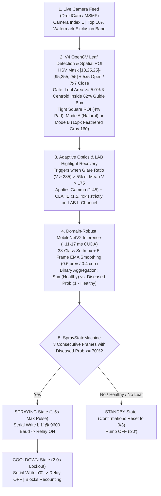

# Intelligent Pesticide Sprinkling System Using CNN


An end-to-end computer vision and embedded hardware actuation system for real-time plant disease recognition and targeted pesticide spraying. Built with **PyTorch**, **OpenCV**, and an **Arduino Uno serial relay controller**, this project progresses systematically from a custom 4-block CNN baseline to a **3-stage domain-robust MobileNetV2** paired with the **V4 Spatial ROI & LAB Highlight-Recovery Vision Pipeline**.

---

## Key Engineering Highlights

* **Zero-Leakage SHA-256 Hash-Isolated Splits:** Audited all **54,305** PlantVillage leaf images across **38 classes**, identifying and isolating **21 exact duplicate hash pairs (42 files)** so identical images never cross train (`38,012`), validation (`8,146`), or held-out test (`8,147`) boundaries (`seed = 42`).
* **4-Stage Model Progression (Custom CNN to Domain-Robust MobileNetV2):**
  * **Custom 4-Block CNN (`best_cnn.pth`, 1.73 MB):** Achieved **97.64%** val accuracy (**97.40%** test accuracy, `0.9634` Macro-F1). Error analysis revealed confusion on fine-grained lesion textures (e.g., *Corn Gray Leaf Spot* vs. *Northern Leaf Blight*).
  * **3-Stage MobileNetV2 Transfer Learning (`best_mobilenet_v2_robust.pth`, 9.35 MB):** Progressed from classifier-head warm-up (**97.35%** val) -> partial top-block fine-tuning (**98.43%** val, **98.49%** test) -> full-network (`2,272,550` params) domain-robust fine-tuning, reaching **99.37% validation accuracy** and **0.9925 Macro-F1**.
* **Massive Domain-Shift Robustness Gains:** Evaluated across a deterministic 190-image stratified stress suite (`5 images/class x 38 classes`), boosting accuracy by **+64.74% under 9x9 motion blur** (`29.47% -> 94.21%`), **+53.16% under 1/4x low resolution** (`41.05% -> 94.21%`), **+16.84% under severe low-light sensor noise**, and **+13.16% under JPEG Q=25 compression**.
* **V4 Real-Time OpenCV Vision Pipeline (`~11-17 ms` GPU Inference):** Eliminates background shortcut learning and screen/sunlight glare via top-10% watermark exclusion, HSV leaf segmentation (`[18, 25, 25]` to `[95, 255, 255]`), centroid-in-guide-box verification, tight `4%`-padded square ROI extraction (**Mode A: Natural Crop** / **Mode B: 15px Feathered Neutral-Gray `160` Mask**), and automatic **LAB L-channel Gamma (`1.45`) + CLAHE (`clipLimit=1.5`, `4x4`)** highlight recovery.
* **Fail-Safe Arduino Relay State Machine:** Protects crops and hardware using a **5.0% minimum leaf-area gate**, **5-frame EMA probability smoothing (`0.6 / 0.4`)**, **3 consecutive disease confirmations (`>= 70%` aggregate diseased probability)**, a bounded **1.5-second pump pulse**, a **2.0-second post-spray cooldown**, automatic `--dry-run` simulation fallback, and guaranteed `b"0"` relay shutoff on exit or serial fault.

---

## System Architecture



---

## Experimental Benchmarks & Model Progression

### 1. Clean Validation & Held-Out Test Set Progression (`n = 54,305` Total Images)

| Model Checkpoint | Training Strategy & Architecture | Model Size | Best Epoch | Val Loss | Val Accuracy (`8,146` imgs) | Val Macro-F1 | Held-Out Test Accuracy (`8,147` imgs) | Held-Out Test Macro-F1 |
| :--- | :--- | :---: | :---: | :---: | :---: | :---: | :---: | :---: |
| `best_cnn.pth` | Custom 4-Block CNN (`~422k` params, trained from scratch) | 1.73 MB | 14 / 19 | `0.0763` | 97.64% | 0.9685 | 97.40% (`7,935/8,147`) | 0.9634 |
| `best_mobilenet_v2.pth` | Stage 1: MobileNetV2 Classifier Head Only (`LR = 1e-3`) | 9.34 MB | 11 / 16 | `0.0822` | 97.35% | 0.9653 | — | — |
| `best_mobilenet_v2_finetuned.pth` | Stage 2: Unfroze `features[-2:]` + Head (`LR = 1e-5 / 1e-4`) | 9.35 MB | 9 / 12 | `0.0485` | 98.43% | 0.9789 | **98.49%** (`8,024/8,147`) | **0.9796** |
| **`best_mobilenet_v2_robust.pth`** | **Stage 3: Full-Network (`2.27M` params, `LR = 1e-5`) + Robust Aug** | **9.35 MB** | **9 / 10** | **`0.0193`** | **99.37%** | **0.9925** | *Untouched per ML policy* | — |

### 2. 190-Image Domain-Shift Stress Benchmark (Baseline vs. Robust MobileNetV2)

Evaluated via `src/inference/evaluate_robustness.py` and `src/inference/evaluate_robust_model.py` across the exact same deterministic stratified subset (**190 images**: 5 images per class across all 38 classes, `seed = 42`):

| Condition | Synthetic Corruption Specification | Baseline Correct | Baseline Accuracy | Baseline Macro-F1 | Robust Correct | Robust Accuracy | Robust Macro-F1 | Accuracy Gain | Macro-F1 Gain |
| :--- | :--- | :---: | :---: | :---: | :---: | :---: | :---: | :---: | :---: |
| **`original`** | Unaltered RGB (`224x224`) | 186 / 190 | 97.89% | 0.9788 | **189 / 190** | **99.47%** | **0.9947** | **`+1.58%`** | **`+0.0159`** |
| **`motion_blur`** | `9x9` Horizontal Motion Blur Filter | 56 / 190 | 29.47% | 0.2726 | **179 / 190** | **94.21%** | **0.9433** | **`+64.74%`** | **`+0.6706`** |
| **`low_resolution`** | `1/4x` Downscale -> Linear Upscale | 78 / 190 | 41.05% | 0.3923 | **179 / 190** | **94.21%** | **0.9409** | **`+53.16%`** | **`+0.5486`** |
| **`low_light_noise`** | `0.40x` Brightness + Gaussian `N(0, 10)` | 67 / 190 | 35.26% | 0.3162 | **99 / 190** | **52.11%** | **0.5367** | **`+16.84%`** | **`+0.2205`** |
| **`jpeg_compression`** | OpenCV JPEG Compression (`quality = 25`) | 156 / 190 | 82.11% | 0.8218 | **181 / 190** | **95.26%** | **0.9525** | **`+13.16%`** | **`+0.1307`** |

### 3. Multi-Severity Degradation Sensitivity Curve (Baseline Vulnerability Analysis)

| Corruption Type | Mild Severity | Moderate Severity | Severe Stress | Key Takeaway |
| :--- | :---: | :---: | :---: | :--- |
| **Motion Blur** | `3x3`: **96.32%** (`183/190`) | `5x5`: **71.58%** (`136/190`) | `9x9`: **29.47%** (`56/190`) | High-frequency leaf venation collapses under camera shake; solved via `RandomMotionBlur`. |
| **Low Resolution** | `0.75x`: **96.32%** (`183/190`) | `0.50x`: **89.47%** (`170/190`) | `0.25x`: **41.05%** (`78/190`) | Distant camera framing destroys lesion sharpness; solved via `RandomDownscale` + tight ROI crop. |
| **Low Light** | `0.75x`: **97.37%** (`185/190`) | `0.55x`: **86.84%** (`165/190`) | `0.40x`: **60.00%** (`114/190`) | Severe underexposure shifts RGB distributions; mitigated via brightness/contrast jitter & LAB CLAHE. |
| **JPEG Artifacts** | `Q=70`: **98.42%** (`187/190`) | `Q=40`: **92.11%** (`175/190`) | `Q=25`: **82.11%** (`156/190`) | DroidCam MJPEG stream artifacts; solved via `RandomJPEGCompression(40, 95)`. |

### 4. Live V4 Camera Pipeline Verification (`live_predict_v4.py` & `live_sprinkler_v4.py`)

| Test Leaf Sample | V4 Vision Mode | Top-1 Prediction | Top-1 Conf. | Aggregate Status | Hardware State Machine | Inference Latency |
| :--- | :---: | :--- | :---: | :--- | :--- | :---: |
| **Apple - Healthy** | Mode A (Natural ROI) | `Apple - healthy` | **99.4%** | `HEALTHY (99.4%)` | `STANDBY (Confirmations: 0/3)` | 11.4 ms |
| **Apple - Apple Scab** | Mode A (Natural ROI) | `Apple - Apple scab` | **95.7%** | `DISEASED (95.7%)` | `SPRAYING! (1.5s) -> COOLDOWN (2.0s)` | 11.2 ms |
| **Strawberry - Healthy** | Mode A (Natural ROI) | `Strawberry - healthy` | **96.8%** | `HEALTHY (97.7%)` | `STANDBY (Confirmations: 0/3)` | 14.5 ms |
| **Strawberry - Healthy** | Mode B (Feathered Gray) | `Strawberry - healthy` | **76.9%** | `HEALTHY (98.4%)` | `STANDBY (Confirmations: 0/3)` | 24.4 ms |
| **Strawberry - Leaf Scorch** | Mode A (Natural ROI) | `Strawberry - Leaf scorch` | **100.0%** | `DISEASED (100.0%)` | `SPRAYING! (1.5s) -> COOLDOWN (2.0s)` | 12.5 ms |

---

## Hardware Architecture & Safety Protocol (`live_sprinkler_v4.py`)

* **Hardware Signal Chain:** Python V4 Decision Layer -> USB Serial (`COM6` default, `9600` baud) -> Arduino Uno -> Relay Module -> Submersible Water Pump (powered via independent supply).
* **Startup Handshake & Fail-Safe Reset:** Waits `2.0s` (`ARDUINO_RESET_DELAY_SECONDS`) after opening serial for the Arduino Uno bootloader reset, flushes buffers, and immediately transmits `b"0"` to force the relay OFF.

| Safety & Control Parameter | `automated_sprinkler.py` (V1 Baseline) | `live_sprinkler_v4.py` (V4 Production) |
| :--- | :--- | :--- |
| **Spatial Leaf Validation Gate** | None (full uncropped frame) | `MIN_LEAF_AREA_FRACTION = 0.05` (`>= 5.0%` area, centroid in guide box, `y >= 10%`) |
| **Temporal Probability Filter** | None (single-frame raw softmax) | 5-frame EMA (`0.6 * prev + 0.4 * curr`); auto-resets on leaf loss or mode toggle |
| **Disease Trigger Criterion** | Single-class `confidence >= 0.90` | Aggregate `diseased_prob >= 0.70` (`1.0 - sum(healthy_probs)`) |
| **Confirmation Window** | `3` consecutive frames of identical class | `CONFIRM_REQUIRED = 3` consecutive frames (`resets to 0` on healthy/no-leaf frame) |
| **Active Spray Pulse Duration** | `1.5` seconds (`b"1"`) | `PUMP_ON_SECONDS = 1.5` seconds (`b"1"`) |
| **Post-Spray Safety Cooldown** | `10.0` seconds + `3` clear frames | `COOLDOWN_SECONDS = 2.0` seconds (`b"0"`, blocks all counting during lockout) |
| **Hardware Fault & Dry-Run Mode** | Hard crash if `COM6` disconnected | Auto-fallback to `SIMULATED (DRY RUN)`; mid-run serial error latches `FAULT` state |

---

## Quickstart & Execution Commands

```powershell
# 1. Run Main Production V4 Sprinkler (Simulation / Dry-Run Mode)
.\.venv\Scripts\python.exe -m src.inference.live_sprinkler_v4 --dry-run

# 2. Run Main Production V4 Sprinkler (Live Arduino Hardware Mode on COM6)
.\.venv\Scripts\python.exe -m src.inference.live_sprinkler_v4 --port COM6 --baud 9600

# 3. Run Standalone V4 Vision Debugger (with 224x224 CNN Input Window)
.\.venv\Scripts\python.exe -m src.inference.live_predict_v4

# 4. Reproduce 190-Image Domain-Robustness Benchmarks
.\.venv\Scripts\python.exe -m src.inference.evaluate_robustness
.\.venv\Scripts\python.exe -m src.inference.evaluate_robust_model

# 5. Run Dataset Split & Tensor Shape Unit Tests
.\.venv\Scripts\python.exe -m tests.test_dataset
```

---

## Live Interactive Keyboard Controls (`live_predict_v4.py` & `live_sprinkler_v4.py`)

| Key | Function | Technical Behavior |
| :---: | :--- | :--- |
| **`m`** | **Toggle ROI Mode (A / B)** | Switches between **Mode A (Natural ROI Crop - Best Accuracy)** and **Mode B (15px-Dilated, 15x15-Blurred Neutral-Gray `160` Mask)**; resets EMA buffer |
| **`c`** | **Cycle LAB Glare Recovery** | Cycles LAB `L`-channel Gamma (`1.45`) + CLAHE (`1.5`, `4x4`) highlight recovery (`AUTO` -> `ON` -> `OFF`) |
| **`w`** | **Toggle White Balance** | Toggles non-leaf Gray-World white balance with gain limits `0.8-1.25` (`OFF` by default to preserve true lesion hues) |
| **`q` / `Esc`** | **Safe Shutdown** | Immediately writes `b"0"` to turn pump OFF, closes serial port in `finally:` block, and exits |

---

## Author

**Navnith N Reddy**  
B.E. in Artificial Intelligence & Machine Learning  
[GitHub](https://github.com/Navnith-7) | [LinkedIn](https://linkedin.com/in/navnith-n-reddy)
